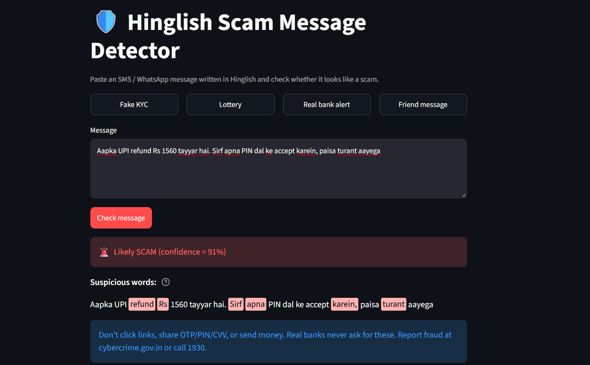

# 🛡️ Hinglish Scam Message Detector

Classifies SMS / WhatsApp messages written in **Hinglish** (Hindi in Roman script) as **scam** or **safe**
(fake KYC, lottery, UPI refund, fake jobs, OTP phishing, utility threats, loan fraud, investment and impersonation scams).
Most scam-detection projects only handle English; this one targets the way people in India actually write.

## Demo
🔗 Live demo: <https://hinglish-scam-detector-necsszqk9d2a6eqxehyq4y.streamlit.app/>



The app shows a Scam/Safe verdict with an approximate confidence score and **highlights the words that pushed the
message towards "scam"** (found by removing each word and measuring the drop in the model's score).

## Dataset
| Part | Rows | Notes |
|---|---|---|
| Template-generated | ~490 | 13 categories, with simulated typing noise (spelling variants, casing) |
| Hand-written | ~200 | Varied wording, plus tricky cases: scams without links, safe messages that mention OTP/KYC/money |
| **After cleaning + de-duplication** | **437** | 202 scam / 235 safe |

Preprocessing: lowercase, replace URLs / phone numbers / amounts with `<url>` `<phone>` `<num>`, normalize common Hinglish spelling variants.
A separate 30-message hand-written test set (`data/my_test.csv`) was used for a second evaluation.

> **Limitation:** the dataset is partly synthetic and small. Scores below are likely higher than real-world performance.

## Models and results
Same 80/20 stratified split (seed 42) for all models. Scam class is the positive class.

| Model | Test acc. | Test scam F1 | my_test acc. | my_test scam F1 |
|---|---|---|---|---|
| **TF-IDF + Linear SVM (used in app)** | 0.977 | 0.976 | 0.967 | 0.966 |
| TF-IDF + Logistic Regression | 0.966 | 0.963 | - | - |
| TF-IDF + Naive Bayes | 0.955 | 0.953 | - | - |
| DistilBERT multilingual (fine-tuned) | 0.943 | 0.938 | 0.967 | 0.966 |
| HingBERT (fine-tuned) | 0.966 | 0.965 | 0.967 | 0.968 |

**Findings**
- On this small dataset, a simple TF-IDF + SVM matched the fine-tuned transformers while being tiny and instant, so it powers the app.
- Character n-grams help with Hinglish because spellings vary (`apka` / `aapka`).
- Qualitative checks showed transformers can be overconfident on unseen wording (e.g. missing an "iPhone prize" scam),
  so a higher-variety dataset matters more than a bigger model.
- Hardest case: a "friend in trouble, send money" message from a new number. The text alone is identical to a real friend's request.

## Project structure
```
data/        raw_messages.csv, clean_messages.csv, my_test.csv
src/         generate_dataset.py, preprocess.py, train_baseline.py, predict.py
notebooks/   day3_transformers.ipynb (Colab fine-tuning)
models/      baseline.joblib, baseline_results.csv, confusion_matrix.png
app.py       Streamlit app
```

## How to run
```
pip install -r requirements.txt
python src/preprocess.py
python src/train_baseline.py
streamlit run app.py
```

## Future work
Collect real (anonymized) scam messages, add Devanagari Hindi support, calibrate probabilities,
and add context signals (unknown sender, new number).
